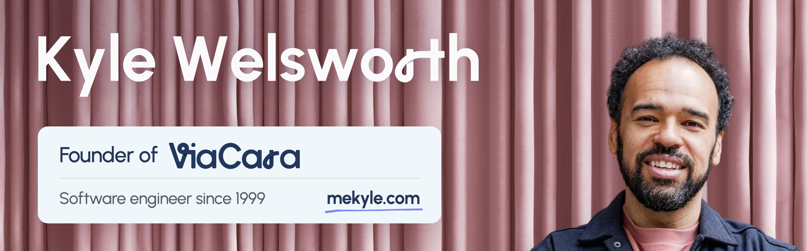

# Hi, I'm Kyle 👋🏾

I'm building [ViaCara](https://viacara.com/) to connect clients with therapists, counsellors, hypnotherapists and coaches on a deeper level. I've built software since 1999.

## 🌱 Now: ViaCara

It started at home. My wife is an independent therapist. Good practitioners are being asked to be marketers, so I'm building the part that helps connect clients with how they work.

- 🎬 Watch the founder film (1 min 37 s) on [mekyle.com](https://mekyle.com/?ref=GitHub).
- 🤝 Are you a therapist, counsellor, hypnotherapist or coach? [Join ViaCara](https://viacara.com/for/). Your first 2 client introductions are free.

## 🛠 Engineering

I've built software products since 1999, from GOV.UK services to an AI-first platform in 7 European markets. Alongside ViaCara I take on a small number of contract engagements in product software engineering, for AI systems and regulated platforms.

| When | Where | What |
|---|---|---|
| 2023 to 2026 | Ophelos / Intrum | Acting Principal. Architect of the AI-first platform: millions of debt cases, 7 European markets. |
| 2021 to 2023 | Shopify | Technical Lead, team of 6. About 2% better checkout conversion at scale. |
| 2013 to 2021 | Independent | FreeAgent Open Banking, Department for Education on GOV.UK, CTO at Universal Data Management. |
| 2010 to 2012 | On The Beach | Holiday booking platforms. |

Hiring a product engineer? Email kyle.welsworth@pm.me, or find me on [LinkedIn](https://www.linkedin.com/in/mekyle/).

## 📦 Open source

- [Soulection Tracklists](https://soulectiontracklists.com/?ref=GitHub): every tracklist from Soulection Radio. I own the domain and maintain the archive of episodes 1 to 654 ([source](https://github.com/kylewelsby/v4.soulectiontracklists.com)).
- [angular-post-message](https://github.com/kylewelsby/angular-post-message): cross-document messages in AngularJS through the `window.postMessage` API.
- [dotsfont](https://github.com/kylewelsby/dotsfont): a work-around for the `-webkit-text-security` property.
- [now-playing-widget](https://github.com/kylewelsby/now-playing-widget): the Last.fm track that is playing now, on a web page or in OBS Studio.

## 🎧 Outside of work

- **Music:** DJ mixes on [SoundCloud](https://soundcloud.com/mekyle) and [Mixcloud](https://www.mixcloud.com/kylewelsby/).
- **Dance:** Brazilian Zouk, on [Instagram](https://www.instagram.com/halfcubedance/).
- **Riding:** on my motorbike.

Photography by Fiona Finchett. The photograph and the ViaCara logo in `banner.jpg` are not covered by this repository's licence.
